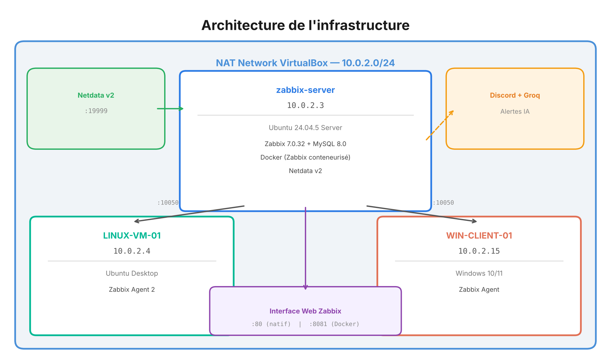
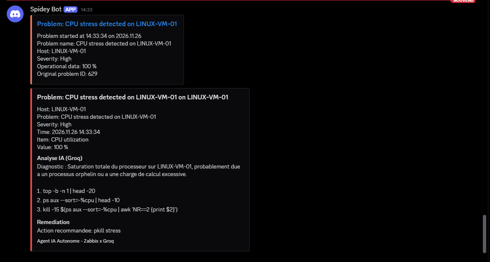
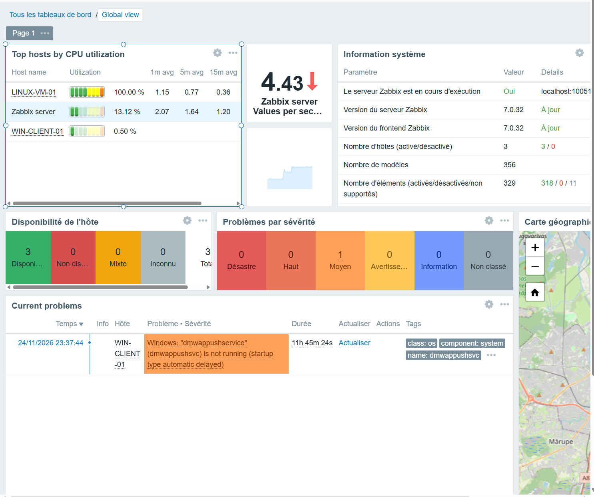
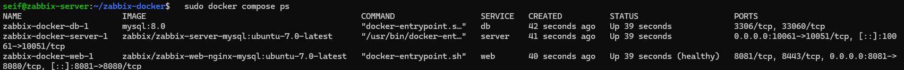

# Supervision d'infrastructure avec Zabbix 7.0 LTS

Projet réalisé pour le module **Approfondissement ISR** (UE2 : Sécurité ISR) à Guardia Cybersecurity School, B2 Cybersécurité, novembre 2026.

J'ai mis en place une supervision centralisée avec Zabbix sur trois machines virtuelles VirtualBox. Les alertes arrivent sur Discord, et un agent IA (Groq) analyse chaque problème pour proposer un diagnostic et des commandes.



## L'infrastructure

| Machine | IP | Système | Rôle |
|---|---|---|---|
| zabbix-server | 10.0.2.3 | Ubuntu 24.04.5 Server | Zabbix 7.0.32, MySQL 8.0, Nginx, Docker, Netdata |
| LINUX-VM-01 | 10.0.2.4 | Ubuntu Desktop | Zabbix Agent 2 |
| WIN-CLIENT-01 | 10.0.2.15 | Windows 10/11 | Agent Zabbix |

Les trois VM sont sur le même NAT Network (10.0.2.0/24). Le serveur interroge les agents sur le port 10050 (vérifications passives) et les agents envoient leurs données sur le port 10051 (vérifications actives).

## Ce que j'ai fait

- **Supervision des 3 hôtes** avec les templates « Linux by Zabbix agent » et « Windows by Zabbix agent » : CPU, mémoire, disque, réseau, uptime, services.
- **Triggers et gravités** : hôte injoignable (Disaster), CPU > 90 % pendant 5 min (High), mémoire > 90 % et service Windows arrêté (Average), moins de 20 % de disque libre (Warning).
- **Un trigger à nous** pour les tests de charge : `last(/LINUX-VM-01/system.cpu.util)>45`, sévérité High.
- **Alertes Discord** via webhook, avec des embeds.
- **Agent IA** : un script d'alerte envoie le problème à l'API Groq (modèle Qwen 27B), qui renvoie un diagnostic et des commandes de vérification. Le tout est posté sur Discord. L'IA propose, elle n'exécute rien : c'est un humain qui valide.
- **Bonus Docker** : une deuxième instance Zabbix sous Docker Compose (voir [`docker/`](docker/)).
- **Bonus Netdata** : installé sur le serveur Zabbix pour « superviser le superviseur », avec des métriques à la seconde.

### Le pipeline d'alerte

```
Trigger (détecte) → Action Zabbix (réagit) → script d'alerte → API Groq → Discord
```



## Tester la chaîne

Sur LINUX-VM-01 :

```bash
stress --cpu 2 --timeout 120   # charge 2 cœurs pendant 2 minutes
top                            # le CPU monte à 100 %
pkill stress                   # arrête la charge
```

L'alerte arrive sur Discord en une à deux minutes.



## Déploiement Docker

```bash
cd docker
cp .env.example .env    # puis mettre de vrais mots de passe
docker compose up -d
```

L'interface est accessible sur le port 8081 et le serveur sur le port 10061 (les ports par défaut sont déjà pris par le Zabbix installé nativement).



## Contenu du dépôt

```
├── rapport/rapport-zabbix-isr.pdf        rapport complet du projet
├── presentation/presentation-zabbix.pdf  support de soutenance
├── docker/docker-compose.yml             instance Zabbix sous Docker
├── docker/.env.example                   modèle des variables (mots de passe)
└── docs/                                 schéma et captures
```

## Pistes d'amélioration

- Laisser l'IA corriger seule les problèmes mineurs, avec une liste d'actions autorisées
- Superviser le réseau (switchs, routeurs) en SNMP
- Haute disponibilité du serveur Zabbix
- Chiffrement TLS entre agents et serveur, authentification LDAP / Active Directory
- Notifications selon la gravité : mail pour un Warning, Discord pour un High, SMS pour un Disaster

## Sécurité

Aucun secret n'est versionné : la clé API Groq, l'URL du webhook Discord et les mots de passe MySQL sont passés par variables d'environnement.
